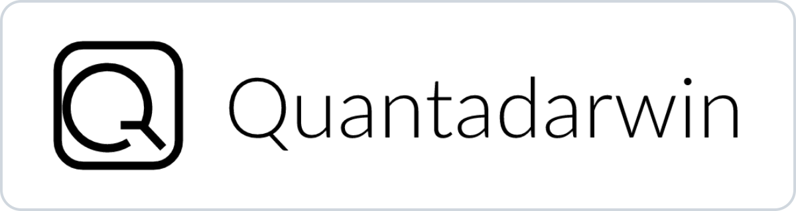

<h1>Quantatier</h1>

Tools for quantitative research and strategy workflows

&#8201;&#8201;&#8201;&#8201;

<a href="#getting-started">Getting Started</a>&#8201;·&#8201;<a href="https://github.com/quantatier-apps/community/discussions/categories/announcements">Updates</a>&#8201;·&#8201;<a href="https://github.com/quantatier-apps/community/issues/new/choose">Report&#160;an&#160;Issue</a>

---

## About Quantatier

Quantatier brings together tools for quantitative strategy research and workflows. **Darwin** provides a local workspace for strategy work and backtesting. **Cloud** is part of Quantatier.

This community is a place to learn about the products, ask questions, share ideas, and follow updates.

## Products

### Darwin

**Your local workspace for strategy research and backtesting.**

Work with strategies, run supported backtests, and review available results on your computer.

- [Local Backtesting](docs/darwin/local-backtesting.md) — run supported backtests locally.
- [Data Manager](docs/darwin/data-manager.md) — work with local historical data.
- [Data Recorder](docs/darwin/data-recorder.md) — record supported live market data locally.

[Getting started with Darwin →](#start-with-darwin) · [Ask the community](https://github.com/quantatier-apps/community/discussions)

### Cloud

Cloud is part of Quantatier. Details about available workflows will be shared after verification.

- [Strategy Workspace](docs/cloud/strategy-workspace.md)
- [Tasks & Results](docs/cloud/tasks-and-results.md)

Available features and workflows depend on the product version and configuration.

## Getting Started

### Start with Darwin

1. Open the Darwin version provided to you.
2. Prepare a supported strategy and the historical data needed for your backtest.
3. Configure and run a local backtest.
4. Review the available results, charts, trades, and logs.

Product access, supported platforms, and setup instructions depend on the version provided to you. Refer to the instructions accompanying your product distribution.

## Updates and Releases

Find product notes and updates in [Announcements](https://github.com/quantatier-apps/community/discussions/categories/announcements).

## Community

### Help and Feedback

For questions, ideas, and workflow discussions, visit [Discussions](https://github.com/quantatier-apps/community/discussions). To report a specific problem or suggest an improvement, use [Issues](https://github.com/quantatier-apps/community/issues). Our [welcome post](https://github.com/quantatier-apps/community/discussions/1) is a good place to start.

When reporting a problem, describe what you were trying to do, what happened, and any steps that help explain it. **Do not share passwords, API keys, account information, private strategies, or other sensitive data in public.**

Community contributions can begin with a question, a reproducible issue, a suggestion, or an improvement to public documentation. To propose a documentation change or share an example, start a discussion first.

## Business Inquiries

Quantatier welcomes inquiries from service providers, integrators, and other prospective business partners about product use and integration needs. Contact details will be shared when available. Please do not post confidential business information in public discussions or issues.

## Third-Party Projects

Quantatier products may incorporate or integrate third-party projects. Those projects remain the property of their respective owners and are subject to their own licenses. Applicable notices and license information are provided with the relevant distribution.

### Libraries and Frameworks

Quantatier’s development uses libraries and frameworks including [PySide6](https://doc.qt.io/qtforpython/), [pyqtgraph](https://www.pyqtgraph.org/), [NumPy](https://numpy.org/), [pandas](https://pandas.pydata.org/), [Vue](https://vuejs.org/), and [Element Plus](https://element-plus.org/).

### Quantitative Projects

Some Darwin components are derived from or incorporate [vn.py](https://github.com/vnpy/vnpy). We thank its authors and contributors.

### References and Future Exploration

Quantatier also draws inspiration from the wider quantitative community, including [vectorbt](https://github.com/polakowo/vectorbt), [Zipline](https://github.com/quantopian/zipline), and Microsoft’s [Qlib](https://github.com/microsoft/qlib). These projects are not currently integrated. Their inclusion does not imply endorsement or partnership.

We thank the authors and contributors of these projects for their work.

---

**Quantatier** · Built for practical quantitative workflows.

[Updates](https://github.com/quantatier-apps/community/discussions/categories/announcements) · [Discussions](https://github.com/quantatier-apps/community/discussions) · [Issues](https://github.com/quantatier-apps/community/issues) · [Business Inquiries](#business-inquiries)

