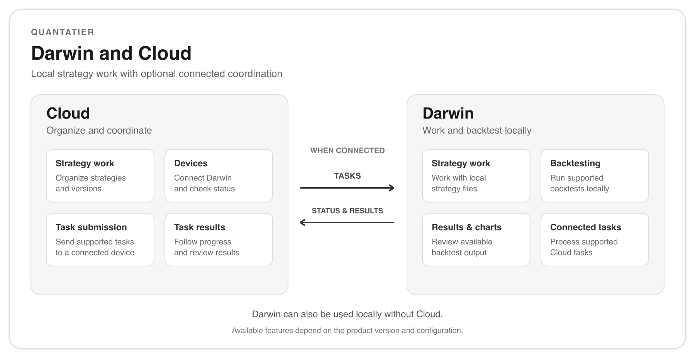

# Quantatier

**Integrated tools for quantitative research and strategy workflows**

Darwin for local strategy work.  
Cloud for connected workflows.

[Explore Products](#products) · [How It Works](#how-it-works) · [Getting Started](#getting-started) · [Community](#community)

[Join Discussions](https://github.com/quantatier-apps/community/discussions) · [Report an Issue](https://github.com/quantatier-apps/community/issues/new/choose)

---

## About Quantatier

Quantatier brings together tools for quantitative strategy research and workflows.

**Darwin** provides a local workspace for strategy work and backtesting. **Cloud** helps organize strategy work and coordinate supported tasks with connected Darwin devices.

This community is a place to learn about the products, ask questions, share ideas, and follow updates.

## Products

### 🖥️ Darwin

**Your local workspace for strategy research and backtesting.**

Darwin brings strategy work and local backtesting together on your computer. It is designed to help you move from preparing a strategy to reviewing backtest results in one workspace.

With Darwin, you can:

- **Prepare strategy work** and configure supported backtests.
- **Run backtests locally** using the historical data available to you.
- **Review results**, including available statistics, charts, trades, and logs.
- **Connect with Cloud** when your workflow uses supported Cloud features.

### ☁️ Cloud

**A connected workspace for organizing strategy work and supported tasks.**

Cloud works alongside Darwin to help organize strategy work and coordinate supported tasks across connected devices.

With Cloud, you can:

- **Organize strategy work** and manage completed versions.
- **Connect a Darwin device** and check its connection status.
- **Submit supported tasks** to a connected device and follow their progress.
- **Review available task information and results.**

> Available features and workflows depend on the product version and configuration.

## How It Works

Darwin supports local workflows on your computer. When a workflow uses Cloud, a connected Darwin device can participate in supported tasks and return available status and results.

**Work locally**  
Prepare your strategy and data, run a supported backtest in Darwin, and review the results on your computer.

**Work with Cloud**  
Prepare strategy work in Cloud, connect a Darwin device, and submit a supported task. Follow its status and review available results in Cloud.

Cloud-coordinated workflows require the appropriate features, configuration, and device connection.

## Getting Started

### Start with Darwin

1. Open the Darwin version provided to you.
2. Prepare a supported strategy and the historical data needed for your backtest.
3. Configure and run a local backtest.
4. Review the available results, charts, trades, and logs.

### Connect Darwin with Cloud

1. Open Cloud and prepare your strategy work.
2. Connect a Darwin device using the instructions provided with your version.
3. Submit a supported task to the connected device.
4. Follow its progress and review available results.

Product access, supported platforms, and setup instructions depend on the version provided to you. Refer to the instructions accompanying your product distribution.

## Community

Quantatier is built around practical workflows and feedback from its users. Whether you are exploring the products or using them in your own workflow, you are welcome to participate.

### 💬 Discussions

Use [Discussions](https://github.com/quantatier-apps/community/discussions) to:

- Ask questions about Darwin and Cloud.
- Share your experience and ideas.
- Discuss workflows and possible improvements.

New here? Start with our [community welcome post](https://github.com/quantatier-apps/community/discussions/1).

### 🐛 Issues

Use [Issues](https://github.com/quantatier-apps/community/issues) to report a problem or suggest a specific improvement.

When reporting an issue, please describe what you were trying to do, what happened, and any steps that help explain the problem. **Do not include passwords, API keys, account information, private strategies, or other sensitive data.**

[Report an issue](https://github.com/quantatier-apps/community/issues/new/choose)

### 🤝 Contribute

Community contributions can begin with a clear question, a reproducible issue, a suggestion, or an improvement to public documentation.

If you would like to propose a documentation change or share an example, start a discussion so we can understand the context and decide how best to include it.

## Updates and Releases

Product news and community updates can be shared through [Discussions](https://github.com/quantatier-apps/community/discussions).

You can check [Releases](https://github.com/quantatier-apps/community/releases) for release information when it is published. Availability and distribution details may vary by product and version.

## Third-Party Projects

Quantatier products may incorporate or integrate third-party projects. Those projects remain the property of their respective owners and are subject to their own licenses.

Applicable notices and license information are provided with the relevant distribution.

---

**Quantatier**

Built for practical quantitative workflows.

[Discussions](https://github.com/quantatier-apps/community/discussions) · [Issues](https://github.com/quantatier-apps/community/issues) · [Releases](https://github.com/quantatier-apps/community/releases)

